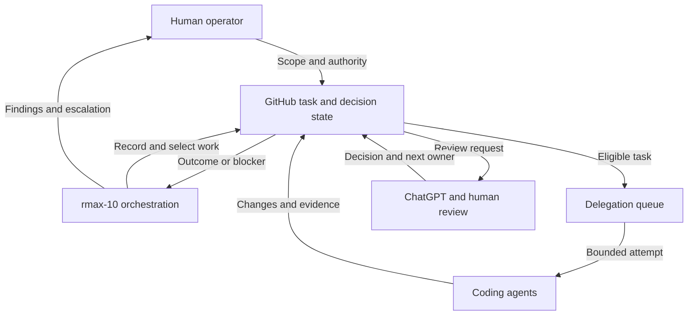

# RMax AI, Year One: From Agents to Verified Work

RMax AI's first year turned experiments with coding assistants into an operating research lab: a persistent agent, bounded execution workflows, reproducible prototypes, technical publications, and a control plane for coordinating work across models. The strongest result was a practical engineering approach to autonomy: make authority, state, ownership, and verification explicit. The largest remaining gap is proving that activity produced a useful, durable outcome. This retrospective follows the work from its November 2025 inception through November 18, 2026, examines what the evidence supports, and proposes three priorities for 2027.

## A year of building the system around the model

The early question was whether agents could take on more software work. By the end of the year, the harder questions concerned everything around that work. Who owns an interrupted task? Which revision passed review? Did a tool actually run? Does an acknowledged answer still require action? Can a useful result be recovered after the conversation that produced it disappears?

Those questions connect the year's apparently different projects: agent runtimes, research assistants, evaluation harnesses, knowledge pipelines, and the publication workflow itself. Each explores how to turn uncertain model output into an inspectable process. The January notes on [agent-first software engineering](https://rmax.ai/notes/agent-first-software-engineering/) established an early statement of that direction. The September [control-plane field report](https://rmax.ai/notes/from-human-orchestrated-agent-to-autonomous-control-plane/) described its operational consequences.

**The central claim is that useful autonomy depends on recoverable state, explicit ownership, and evidence for each consequential transition.** A capable model helps perform the work. The surrounding system determines whether that work can be trusted, resumed, reviewed, and maintained.

This account combines the earlier public field report, project documentation, and an operational audit collected by rmax-10 on November 18. The audit inspected repository history, session records, scheduled jobs, task outcomes, and review findings. Its aggregate figures are historical observations, not a fresh independent reproduction. The [companion evidence notes](../processed/rmax-ai-year-one-from-agents-to-verified-work/evidence-notes.md) preserve definitions, corrections, and unresolved measurement issues.

## The chronology, including the gaps

The project's inception is dated to November 2025 in the operator's account. The audit found no surviving artifact for that month; its earliest durable repository evidence begins on December 23. The public field report also records December experiments with a persistent VPS assistant and January infrastructure work as operator history. These sources describe different kinds of evidence and should remain distinguishable.

| Period | What changed | Evidence boundary |
|---|---|---|
| November 2025 | The initiative's starting point in the operator's account. | No durable artifact found by the audit. |
| December 2025 | Site and repository foundations appear from December 23; early assistant experiments form the prehistory. | Repository dates and operator recollection are separate evidence. |
| January 2026 | Public notes begin on January 3. Execution contracts, authority, and earned autonomy become recurring themes. Surviving OpenClaw agent records begin January 31. | Earliest surviving records do not establish the date of every prior experiment. |
| February–March | Autonomous editing, the software-engineering book project, workflow experiments, and Shardlake expand the implementation portfolio. | Commit volume records activity; it does not establish finished products. |
| April | The audit finds no indexed organization commits or issues, and 30 heartbeat-only agent sessions. | Observed dormancy; the records alone do not explain its cause. |
| May | The assistant moves to Hermes on May 11; scheduled work and knowledge-processing workflows expand. | Migration is documented; uninterrupted reliability is not implied. |
| June–July | Governed research, bounded agent loops, identity, evidence, and harness design become a substantial cluster of projects and writing. | Maturity varies by repository. |
| August | Media processing, telemetry experiments, and the MCP gateway broaden the supporting system. | Infrastructure presence is distinct from current health. |
| September | Delegation, the ChatGPT request channel, system review, and architecture records make coordination more explicit. | The public field report documents both mechanisms and failures. |
| October | Repeated decision-model benchmarks, operational reviews, and a growing issue workflow expose verification and maintenance costs. | Results are specific to dated workloads and environments. |
| November 1–18 | Runtime maintenance, further evaluation, self-improvement audits, and this retrospective sharpen the next set of priorities. | The reporting window closes on November 18. |

The chronology is less smooth than a conventional progress story. April matters precisely because it interrupts the growth narrative. A recurring process can remain alive without producing useful work. That observation motivates better progress detection; it does not prove that the platform, the model, or the operator alone caused the pause. [Evidence notes](../processed/rmax-ai-year-one-from-agents-to-verified-work/evidence-notes.md)

## What the year produced

The November audit counted **145 repositories** across the organization. That includes experiments, scaffolds, supporting infrastructure, and imported history. It is a measure of the portfolio's size, not a count of finished applications. A more useful assessment groups the work by what it demonstrates.

**Governed application workflows.** [Deep Research Assistant](https://github.com/rmax-ai/deep-research-assistant) documents a 27-node workflow with 14 bounded agents, persisted checkpoints, approval branches, and claims linked to evidence. Continuous research remains partial, and live-model validation is separate from deterministic checks. [Relocation Scout](https://github.com/rmax-ai/relocation-scout) makes a related boundary visible in a smaller application: code enforces state and approval rules, agents assess listings and draft messages, and a human authorizes external action. It remains a proof of concept with mock email and no production authentication.

**Reusable execution patterns.** [ADK Loop Lab](https://github.com/rmax-ai/adk-loop-lab) implements document refinement, evidence research, and resumable coding examples. Its contribution is the surrounding loop: persisted state, verification, budget controls, and explicit stopping decisions. The [portable skills repository](https://github.com/rmax-ai/skills) captures reusable procedures in versioned artifacts. Those artifacts make adoption possible; their existence alone does not show that every workflow uses them correctly.

**Research and evaluation.** [Jev versus Clef](https://github.com/rmax-ai/jev-vs-clef) supplies dated runs and raw calls for a concrete model-substitution question. Other laboratories investigate recursive execution, retrieval choices, regeneration, and the fit between a model and its harness. The transferable accomplishment is an experimental structure that can preserve a negative or changed result. A repository name or evaluation scaffold alone does not demonstrate that a hypothesis succeeded.

**Knowledge and publication.** Video-insight processing, knowledge-graph work, and the [static insights explorer](https://github.com/rmax-ai/yt-insights-explorer) connect source material to inspectable artifacts. Extracted claims still need verification. On the writing side, the corrected census found **77 dated technical notes**, plus one redirect page: **78 published note pages**, not 78 distinct articles. The public [notes index](https://rmax.ai/notes/) makes the writing accessible; the audit did not obtain readership or adoption data.

**An operating coordination system.** The most consequential integration joins rmax-10, ChatGPT, coding-agent execution, GitHub state, and human review. Hermes is an upstream framework adopted and extended for this system. RMax's contribution lies in its integration, protocols, experiments, and operational practice; imported upstream history is not original lab output. [Evidence notes](../processed/rmax-ai-year-one-from-agents-to-verified-work/evidence-notes.md)

## How the coordination loop works

The architecture separates communication from durable state. Slack provides a place to request attention and coordinate. GitHub holds the task, its ownership, implementation artifacts, and review history. A local delegation queue manages attempts through coding-agent execution paths. ChatGPT supplies another reasoning and review surface through a structured request channel. The operator retains consequential approval decisions.

*Conceptual ownership and feedback diagram. Arrows describe responsibilities, not a guarantee that every historical task completed this path. Slack coordination and runtime details are omitted for clarity. The [September field report](https://rmax.ai/notes/from-human-orchestrated-agent-to-autonomous-control-plane/) documents the operational model and its failure cases.*

This separation makes asynchronous collaboration recoverable. A new session can inspect the task rather than reconstructing intent from fragments of chat. An execution attempt can fail while the work item survives. A reviewer can reject a change without losing the original request. The value comes from preserving those distinctions consistently.

### Example 1: an answer can arrive while the work remains open

The September field report describes a failure in which a response was marked consumed while follow-up work remained unresolved. Successful delivery had been treated as successful completion. Similar failures included tools that existed but were not wired into their intended workflow, and ownership lost across handoffs.

The correction is a stronger completion model. A received answer needs an explicit disposition: implemented and verified, delegated with a new owner, waiting on a named decision, or closed with a recorded reason. The acknowledgement belongs to the communication protocol. The disposition belongs to the work lifecycle. Both need evidence. [Control-plane field report](https://rmax.ai/notes/from-human-orchestrated-agent-to-autonomous-control-plane/)

That lesson also changes how the annual numbers should be read. The November queue census recorded **1,078 tasks**, including **809 in `SUCCEEDED`**, 210 failed, 58 cancelled, and one running. Those states sum correctly. They do not establish 809 deployed improvements or 809 independently verified useful outcomes. The distinction is essential when the system itself has documented hollow completion.

### Example 2: preserving a result that changed

The Jev/Clef experiment ran the same 159-call battery on October 3 and October 6. On the subset of 24 author-labelled decisions, Clef 27B matched the labels in 96% of cases in both runs, while Jev moved from 92% to 83%. The repository retains both runs, their raw calls, and a comparison of the results. [Benchmark evidence](https://github.com/rmax-ai/jev-vs-clef)

The useful finding is bounded. Twenty-four synthetic labelled decisions cannot establish a universal model ranking. Agreement between models is a different measurement from agreement with the author's labels. Hosted latency depends on the measurement environment. Preserving the rerun makes those limitations inspectable and prevents a convenient first result from becoming permanent truth.

This is a model for the rest of the lab: retain the task definition, the environment, the observed result, and the evidence that might change the conclusion.

## Where the system still falls short

**Verification requires its own verification.** The annual audit reported 518 `ACCEPTANCE_FAILED` records against 1,375 attempts, or 37.7%. Its detailed attempt categories do not reconcile to that total, so the companion notes flag the rate for reconciliation. Even a reconciled category would not explain every failure. Some may reflect weak task definitions or incorrect execution context; others may be valid rejections of incomplete work. The useful next action is to classify the causes before changing the gate. [Evidence notes](../processed/rmax-ai-year-one-from-agents-to-verified-work/evidence-notes.md)

**Detection has outpaced demonstrated learning.** The audit recorded 155 system-review findings, with silent degradation the largest category at 41. Detecting a problem, proposing a repair, and retaining a lesson are different achievements. A convincing improvement trace needs a failing observation, a reviewed change, evidence that the changed system ran, and a later observation showing the failure was reduced. A new skill file or another report establishes only part of that trace.

**Coordination creates maintenance work.** The audit counted 291 open request-channel issues. Open does not automatically mean abandoned: some work legitimately awaits review or another owner. The concern is whether each item has a meaningful next state. Repository and skill growth creates a similar obligation. With 145 repositories and 317 installed skills in the snapshot, discovery, overlap, ownership, and retirement become engineering problems of their own. These counts motivate a maintenance review; they do not measure its cost directly.

**The economic picture is incomplete.** The audit reports $298.27 of tracked agent cost for September through the November cutoff. That is neither the year's total expenditure nor a return-on-investment calculation. Earlier cost attribution, infrastructure, operator time, and the value of outcomes remain incomplete. Reported token counts also include context reuse and cannot simply be converted into unique billed consumption.

These limitations constrain the autonomy claim. The evidence supports a substantial supervised system capable of sustained delegation and self-observation. It does not establish dependable end-to-end self-improvement or independence from human recovery and judgment. [Evidence notes](../processed/rmax-ai-year-one-from-agents-to-verified-work/evidence-notes.md)

## Three proposed priorities for 2027

The next phase should improve the fraction of work that reaches a verified, maintainable outcome. The following are proposed objectives for an initial 90-day programme, not commitments or completed work.

### 1. Make delivery evidence reliable

Start by reconciling the attempt census and classifying its largest acceptance-failure groups. Separate actual implementation defects from invalid checks, missing artifacts, incorrect working directories, and infrastructure failures. Each implementation task should identify what will be checked and what evidence establishes completion.

The audit proposed reducing acceptance failures toward 10%. That target is useful only alongside an independent check that delivered work remains correct. Otherwise, weakening acceptance can manufacture improvement. Track verified outcomes and repeat failures as well as pass rates; preserve a small reviewed sample of failures and successes. The first step is a cause-based review of existing attempts, using the current queue rather than another reporting mechanism.

### 2. Give every handoff a disposition

Use the existing request channel to make ownership and the next action explicit. A proposal from the audit is to disposition at least 95% of answered requests within 48 hours. Its suggested reduction from 291 open issues toward 60 should remain a secondary maintenance indicator.

Closing an issue without resolving or transferring its work is the failure this objective must prevent. A valid disposition should name a completed result, a linked follow-up owner, a deliberate deferral, or a reason no action is needed. Start with the oldest unresolved answers and record what happened to the work, not merely what happened to the issue label.

### 3. Consolidate the portfolio around reusable results

Classify the repository portfolio into maintained systems, supporting components, active experiments, and archival candidates. Consolidate overlapping evaluation work around a shared results index and explicit ownership. A useful first-quarter deliverable would be three reproducible case studies, each connecting a claim to a runnable example, a measured result, and a documented limitation.

The audit suggested a ceiling of 110 active repositories. That is a candidate planning target, not a validated optimum. Before archiving anything, check consumers, references, and unfinished work; preserve the restoration path. Rarely used skills may still support important recovery tasks. Usage alone should not decide their removal.

The practical choice is to continue experiments while requiring them to produce reusable evidence. Consolidation should make prior work easier to use and maintain, without erasing the record that explains how it developed.

## Practical takeaways

- **Define completion before delegation.** Name the artifact, its verification, the decision owner, and the condition for stopping or handing back.
- **Keep communication and work states distinct.** A delivered message, accepted task, merged change, deployed revision, and useful outcome require different evidence.
- **Preserve failed and changed results.** A rerun that weakens a claim can improve the research if the comparison remains reproducible.
- **Audit the measurement path.** A status label or green check is informative only when its source, coverage, and failure behaviour are known.
- **Budget for maintenance.** Every repository, job, skill, and agent adds obligations for ownership, diagnosis, and eventual retirement.

Year one produced enough real systems and experiments to test the original ambition against operational evidence. The next year's progress should be visible in fewer ambiguous handoffs, stronger proof of delivery, and work that other people can reproduce and use.

## Positioning note

This is an applied field report from a personal lab. It is not a controlled study of autonomous software engineering, vendor documentation, or a claim that the architecture is universally optimal.

## Status and scope

Project implementations range from early prototypes to operational components; historical deployment does not certify present reliability. The operational aggregates come from rmax-10's November 18, 2026 audit, with corrections and limitations retained in the evidence notes. Editorial review and illustration work remain pending for this draft. AI assistance contributed to the research synthesis and writing.

## Sources

1. [Companion evidence notes: methods, denominators, corrections, and gaps](../processed/rmax-ai-year-one-from-agents-to-verified-work/evidence-notes.md).
2. [RMax AI public notes](https://rmax.ai/notes/) and [publication repository](https://github.com/rmax-ai/rmax-ai.github.io).
3. [Agent-First Software Engineering](https://rmax.ai/notes/agent-first-software-engineering/).
4. [From Human-Orchestrated Agent to Autonomous Control Plane](https://rmax.ai/notes/from-human-orchestrated-agent-to-autonomous-control-plane/).
5. [Deep Research Assistant](https://github.com/rmax-ai/deep-research-assistant), [Relocation Scout](https://github.com/rmax-ai/relocation-scout), and [ADK Loop Lab](https://github.com/rmax-ai/adk-loop-lab).
6. [Portable skills](https://github.com/rmax-ai/skills) and [YT Insights Explorer](https://github.com/rmax-ai/yt-insights-explorer).
7. [Jev/Clef experiment, dated runs, and caveats](https://github.com/rmax-ai/jev-vs-clef).
