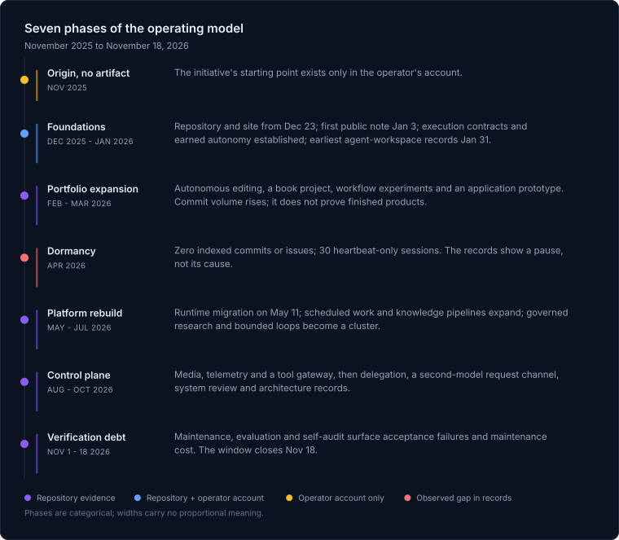
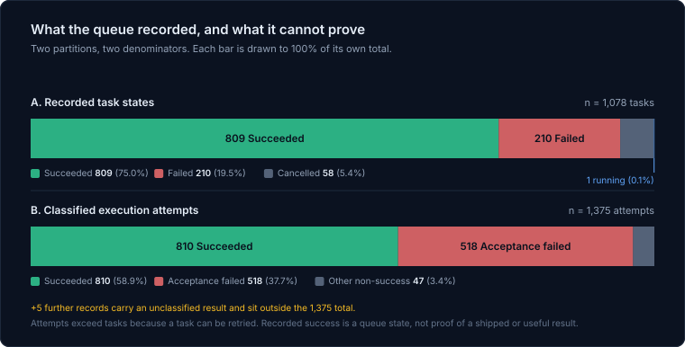

# RMax AI, Year One: From Agents to Verified Work

RMax AI began in November 2025 with a narrow question: how much software work can an agent take on? By the following November the operator faced a different set of questions. Who owns an interrupted task? Which revision passed review? Can a useful result be recovered after the conversation that produced it disappears?

**Useful autonomy depends on recoverable state, explicit ownership, and evidence for consequential decisions.** A model can submit a patch. Someone taking over tomorrow needs the request, the revision, the check that ran, and the decision about what happens next.

The evidence base is a November 18, 2026 operational audit of the lab's own repositories, sessions, scheduled jobs, task outcomes, and review findings, plus two public field reports written during the year. The audit is a historical observation of a system inspecting itself, not an independent reproduction. Numbers in this article carry their denominator and their cutoff; where the audit's own figures disagree with each other, this article reports the disagreement rather than resolving it silently. The [evidence appendix](evidence-notes/) records every definition, correction, and unresolved measurement.

## A year of building the system around the model

The early work assumed the bottleneck was capability. The year's projects, read together, show the bottleneck moving: from whether an agent can produce a change, to whether the change can be judged, attributed, and kept.

Those apparently different projects — agent runtimes, research assistants, evaluation harnesses, knowledge pipelines, and the publication workflow itself — all explore the same question: how do you turn uncertain model output into an inspectable process? The January notes on [agent-first software engineering](https://rmax.ai/notes/agent-first-software-engineering/) stated the direction early. The September [control-plane field report](https://rmax.ai/notes/from-human-orchestrated-agent-to-autonomous-control-plane/) described what it cost to operate.

## The chronology, including the gaps

The project's inception is dated to November 2025 in the operator's account. The audit found no surviving artifact for that month; its earliest durable repository evidence begins on December 23. The public field report also records December experiments with a persistent VPS assistant and January infrastructure work as operator history.

*Figure 1 — Seven phases of the operating model, with the two periods the records do not explain. Segment widths are not proportional to elapsed time; the phases are categorical. Sources: repository history, session records, and the November 18 audit.*

| Period | What changed | Evidence boundary |
|---|---|---|
| November 2025 | The initiative's starting point in the operator's account. | No durable artifact found by the audit. |
| December 2025 | Site and repository foundations appear from December 23; early assistant experiments form the prehistory. | Repository dates and operator recollection are separate evidence. |
| January 2026 | Public notes begin on January 3. Execution contracts, authority, and earned autonomy become recurring themes. Surviving OpenClaw workspace records begin January 31. | Earliest surviving records do not date every prior experiment. |
| February–March | Autonomous editing, a software-engineering book project, workflow experiments, and an application prototype expand the implementation portfolio. | Commit volume records activity; it does not establish finished products. |
| April | Zero indexed organization commits or issues; 30 heartbeat-only agent sessions. | Observed dormancy; the records do not explain its cause. |
| May | The assistant moves to the upstream Hermes runtime on May 11; scheduled work and knowledge-processing workflows expand. | Migration is documented; uninterrupted reliability is not implied. |
| June–July | Governed research, bounded agent loops, identity, evidence, and harness design become a substantial cluster of projects and writing. | Maturity varies by repository. |
| August | Media processing, telemetry experiments, and a tool gateway broaden the supporting system. | Infrastructure presence is distinct from current health. |
| September | Delegation, the second-model request channel, system review, and architecture records make coordination explicit. | The public field report documents both mechanisms and failures. |
| October | Repeated decision-model benchmarks, operational reviews, and a growing issue workflow expose verification and maintenance costs. | Results are specific to dated workloads and environments. |
| November 1–18 | Runtime maintenance, further evaluation, self-improvement audits, and this retrospective sharpen the next set of priorities. | The reporting window closes on November 18. |

April posed a practical problem for the operator. A heartbeat could confirm that a recurring process was alive even when the inspected records showed no work advancing. The distinction matters when choosing what to monitor after a restart. The audit cannot establish the cause of the pause or describe activity outside the records it inspected.

## What the year produced

The November audit counted **145 repositories** across the organization, including experiments, scaffolds, supporting infrastructure, and imported upstream history. That is a measure of portfolio size, not a count of finished applications. Grouping the work by what it demonstrates is more useful.

**Governed application workflows.** [Deep Research Assistant](https://github.com/rmax-ai/deep-research-assistant) documents a 27-node workflow with 14 bounded agents, persisted checkpoints, approval branches, and claims linked to evidence; continuous research remains partial, and live-model validation is separate from its deterministic checks. [Relocation Scout](https://github.com/rmax-ai/relocation-scout) makes a related boundary visible in a smaller application: the prototype assigns state transitions and approval checks to code, agents assess listings and draft messages, and a human authorizes external action. It remains a proof of concept with mock email and no production authentication.

**Reusable execution patterns.** [ADK Loop Lab](https://github.com/rmax-ai/adk-loop-lab) implements document refinement, evidence research, and resumable coding examples; its contribution is the surrounding loop of persisted state, verification, budget controls, and explicit stopping decisions. The [portable skills repository](https://github.com/rmax-ai/skills) captures reusable procedures as versioned artifacts. Those artifacts make adoption possible; their existence does not show that every workflow uses them correctly.

**Research and evaluation.** [Jev versus Clef](https://github.com/rmax-ai/jev-vs-clef) supplies dated runs and raw calls for a concrete model-substitution question; other laboratories investigate recursive execution, retrieval choices, regeneration, and model–harness fit. The transferable accomplishment is an experimental structure that can preserve a negative or changed result — a repository name or evaluation scaffold alone does not demonstrate that a hypothesis succeeded.

**Knowledge and publication.** Video-insight processing, knowledge-graph work, and the [static insights explorer](https://github.com/rmax-ai/yt-insights-explorer) connect source material to inspectable artifacts; extracted claims still need verification. On the writing side, the corrected census found **77 dated technical notes** plus one redirect page — **78 published note pages**, not 78 distinct articles. January's 17 notes are the publication peak, not June's 14. The public [notes index](https://rmax.ai/notes/) makes the writing accessible; the audit obtained no readership or adoption data.

**An operating coordination system.** The most consequential integration joins a persistent rmax-10 orchestrator, ChatGPT for analysis and review, bounded Codex and Droid execution, GitHub state, and human review. The agent runtime is an upstream framework adopted and extended for this system; the lab's contribution lies in the integration, protocols, experiments, and operational practice, and imported upstream history is not original output.

## How the coordination loop works

The architecture separates communication from durable state. Chat and Slack are places to request attention. GitHub holds the task, its ownership, implementation artifacts, and review history. A local delegation queue manages attempts through coding-agent execution paths. A second model supplies an additional reasoning and review surface through a structured request channel. The operator retains consequential approval decisions.

*Figure 2 — On desktop the red dashed arrow leads from the acceptance gate to execution for a retry. The dotted amber arrow leads from disposition to GitHub task state for a proposed follow-up. On mobile, labels describe both returns. The [September field report](https://rmax.ai/notes/from-human-orchestrated-agent-to-autonomous-control-plane/) documents the responsibilities and observed handoff failures.*

The separation makes asynchronous collaboration recoverable. A new session can inspect the task instead of reconstructing intent from fragments of chat. An execution attempt can fail while the work item survives. A reviewer can reject a change without losing the original request. None of that is automatic: it holds only where the state is written down at the moment authority changes hands.

The audit contains acceptance verdicts. It does not track whether a reviewer’s finding later changed another task’s acceptance criteria or the instructions used by the next agent.

### When an answer leaves work open

The September field report describes a failure in which a response was marked consumed while follow-up work remained unresolved. Successful delivery had been treated as successful completion. Similar failures included tools that existed but did not run in their intended workflow, and ownership lost across handoffs.

The correction is a stronger completion model. A received answer needs an explicit disposition: implemented and verified, delegated with a new owner, waiting on a named decision, or closed with a recorded reason. The acknowledgement belongs to the communication protocol; the disposition belongs to the work lifecycle. Both need evidence.

That lesson changes how the annual numbers should be read. The November queue census recorded **1,078 tasks**: 809 in `SUCCEEDED`, 210 failed, 58 cancelled, and one still running. Those states sum correctly, and they are still not 809 deployed improvements. The system has documented hollow completion — a lane reporting success with a valid task record and no committed change — so a success label is a statement about the queue, not about the software.

*Figure 3 — Recorded task states on November 18. The running task was still open at collection. A success label alone supplies no independent evidence of deployment or use.*

### What a preserved rerun lets a reader check

The [Jev/Clef benchmark](https://github.com/rmax-ai/jev-vs-clef) preserves the questions, raw calls and dated results from two runs of the same 159-call battery. Only 24 of the 159 calls in each run tested decisions against the author’s labels. On that subset Jev’s reported agreement fell from 92% on October 3 to 83% on October 6. Clef 27B scored 96% on both dates. The second result changed what a reader could say about substituting Jev for Clef on those questions.

A reader comparing the runs needs the execution date as well as the directory name. The second directory says October 4, while the run took place on October 6. The raw calls also let a reader distinguish two models giving the same answer from either model matching the label. Neither test establishes a universal model ranking. The author supplied the labels for synthetic decisions. Timing depended on the measurement environment, and a November follow-up separately corrected a client-path latency measurement.

## Where the system still falls short

**Verification requires its own verification.** The audit reported 518 acceptance failures against a stated total of 1,375 attempts, or 37.7%. Its listed category counts sum to 1,380. The original query was not rerun and neither figure was independently recounted. The difference of five does not identify which records belong to either total.

The audit did not classify causes. Unclear criteria, an incorrect working directory, a missing artifact, a faulty evaluator and an implementation defect are hypotheses a reviewer could test against individual attempts. The aggregate rate cannot tell an operator which repair to make.

**Detection has outpaced demonstrated learning.** The audit recorded 155 system-review findings, with silent degradation the largest category at 41. Detecting a problem, proposing a repair, and retaining a lesson are three different achievements. A convincing improvement trace needs a failing observation, a reviewed change, evidence that the changed system ran, and a later observation showing the failure was reduced. A new skill file or another report establishes one part of that trace, usually the first.

**Coordination creates maintenance work.** The audit counted 291 open request-channel issues against 844 requests over 59 days; the three status labels account for 834 of those requests (590 consumed, 241 answered, 3 pending), and the remaining ten are unaccounted for by any supplied cross-tabulation, so this article leaves them unclassified. Open does not mean abandoned: some work legitimately awaits review or another owner. The concern is whether each item has a meaningful next state. Growth creates a similar obligation — with 145 repositories and 317 installed skills in the snapshot, discovery, overlap, ownership, and retirement become engineering problems of their own.

**The economic picture is incomplete.** The audit reports $298.27 of tracked agent cost for September through the November cutoff. That is neither the year's total expenditure nor a return-on-investment calculation. Earlier cost attribution, infrastructure, operator time, and the value of outcomes remain unmeasured. Reported token counts include context reuse and cannot be converted into unique billed consumption.

These limitations constrain the claim. The evidence supports a substantial supervised system capable of sustained delegation and self-observation. It does not establish dependable end-to-end self-improvement, or independence from human recovery and judgment.

## A proposed 90-day scorecard for 2027

Day 1 after operator approval opens the proposed measurement window. The historical counts identify work to inspect. Owners would establish the starting populations, record their inclusion rules and retain the identifiers needed to follow a request across retries. The first review would use the following artifacts.

| Priority | Owner role / owning system | Baseline status | First reviewable artifact | 90-day measure (numerator / denominator / window) | Anti-gaming condition |
|---|---|---|---|---|---|
| Reliable delivery | Queue maintainer and independent reviewer | Unresolved baseline for attempt membership and verified outcomes. | Reconciled attempt ledger with a cause review of sampled failures. | Acceptance failures / all reconciled attempts during days 1–90. Proposed target of 10%. Also report independently verified deliveries / implementation tasks opened in the window. | Keep check versions and review samples of passes as well as failures. Count retries separately from tasks. |
| Handoff ownership | Request-channel operator | Historical snapshot of 291 open issues. Unresolved baseline for time to disposition. | Answer register linking each response to an owner, timestamp and disposition. | Answers dispositioned within 48 hours / all requests answered on days 1–88. The proposed 95% target allows each answer its full 48 hours before day 90. | Inspect transfers and reasons for closure. The proposed 60-open target is secondary to resolving the work. |
| Reusable results | Portfolio maintainers | Historical inventory of 145 repositories. Unresolved baseline for maintained, reproducible outcomes. | Results index naming an owner, runnable example, expected result and limitation for each candidate. | Entries independently reproduced with a current maintainer / all entries nominated at the start, assessed by day 90. | Retain failed reproductions and missing owners in the denominator. The proposed 110-repository ceiling is secondary to maintained results. |

A delivery reviewer would begin with the revision the executor actually used. The command, working directory and expected artifact are part of the record. A failing check against the wrong directory calls for a different response from a valid rejection of an incomplete implementation. An unresolved case should keep its place in the ledger until someone can distinguish those explanations.

For the handoff review, start with the oldest unresolved answers. A disposition can document verified completion, a linked transfer accepted by the next owner, deliberate deferral, or a reason that no action is needed. A consumed response on its own answers none of those questions. Record enough of the handoff for someone outside the original conversation to follow it.

For portfolio review, distinguish maintained systems, supporting components, active experiments and potential archives. Check consumers and unfinished work before proposing a retirement, and preserve a restoration path. A rarely used skill may still support an important recovery procedure. Reproducing a result from its recorded inputs gives the maintainer a concrete test of whether consolidation preserved what another operator needs.

## Practical takeaways

- **Define completion before delegation.** Name the artifact, its verification, the decision owner, and the condition for stopping or handing back.
- **Keep communication and work states distinct.** A delivered message, an accepted task, a merged change, a deployed revision, and a useful outcome each require different evidence.
- **Preserve failed and changed results.** A rerun that weakens a claim improves the research if the comparison stays reproducible.
- **Audit the measurement path.** A status label or green check is informative only when its source, coverage, and failure behaviour are known.
- **Budget for maintenance.** Every repository, job, skill, and agent adds obligations for ownership, diagnosis, and eventual retirement.

At day 90 the operator could take the implementation tasks opened during the window and ask how many produced a result an independent reviewer could verify and a named maintainer could still use. Keep unfinished work in that denominator. Year one supplied task records and dated artifacts from which to start asking that question. It left the answer open.

## Positioning note

This is an applied field report from a personal lab. It is not a controlled study of autonomous software engineering, vendor documentation, or a claim that the architecture is universally optimal.

## Status and scope

Project implementations range from early prototypes to operational components; historical deployment does not certify present reliability. The operational aggregates are a November 18, 2026 snapshot of the lab's own audit, with corrections and limitations retained in the [evidence appendix](evidence-notes/); they are not live counters. AI assistance contributed to the research synthesis, the operational audit, and the editorial revision.

## Sources

1. [Evidence appendix: metric definitions, denominators, and corrections](evidence-notes/).
2. [RMax AI public notes](https://rmax.ai/notes/) and the [publication repository](https://github.com/rmax-ai/rmax-ai.github.io).
3. [Agent-First Software Engineering](https://rmax.ai/notes/agent-first-software-engineering/).
4. [From Human-Orchestrated Agent to Autonomous Control Plane](https://rmax.ai/notes/from-human-orchestrated-agent-to-autonomous-control-plane/).
5. [Deep Research Assistant](https://github.com/rmax-ai/deep-research-assistant), [Relocation Scout](https://github.com/rmax-ai/relocation-scout), and [ADK Loop Lab](https://github.com/rmax-ai/adk-loop-lab).
6. [Portable skills](https://github.com/rmax-ai/skills) and [YT Insights Explorer](https://github.com/rmax-ai/yt-insights-explorer).
7. [Jev/Clef experiment: dated runs, raw calls, and caveats](https://github.com/rmax-ai/jev-vs-clef).
