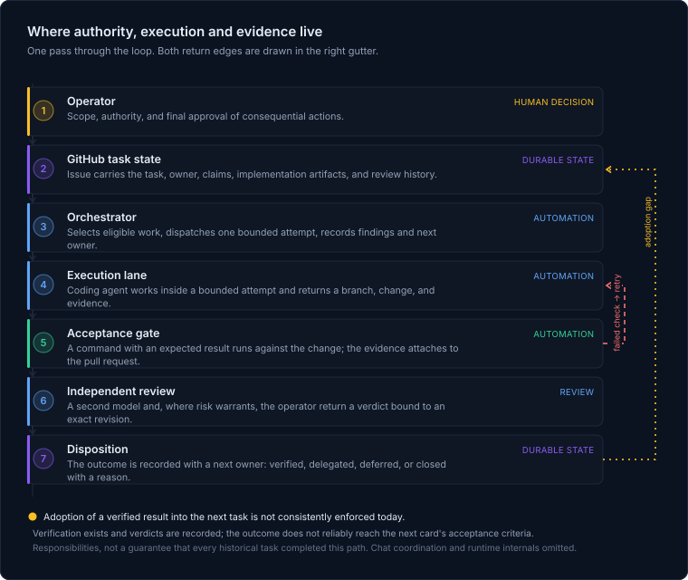

# RMax AI, Year One: From Agents to Verified Work

RMax AI began in November 2025 with a narrow question: how much software work can an agent take on? A year and a thousand delegated tasks later, that question was no longer the interesting one. The interesting questions were about everything around the work. Who owns an interrupted task? Which revision passed review? Did a tool actually run, or was it merely installed? Can a useful result be recovered after the conversation that produced it disappears?

**The central claim of this retrospective is that useful autonomy depends on recoverable state, explicit ownership, and evidence for every consequential transition.** A capable model performs the work. The surrounding system decides whether that work can be trusted, resumed, reviewed, and maintained. Most of what follows is an account of building that surrounding system, and of the places where it still does not hold.

The evidence base is a November 18, 2026 operational audit of the lab's own repositories, sessions, scheduled jobs, task outcomes, and review findings, plus two public field reports written during the year. The audit is a historical observation of a system inspecting itself, not an independent reproduction. Numbers in this article carry their denominator and their cutoff; where the audit's own figures disagree with each other, this article reports the disagreement rather than resolving it silently. The [evidence appendix](evidence-notes/) records every definition, correction, and unresolved measurement.

## A year of building the system around the model

The early work assumed the bottleneck was capability. The year's projects, read together, show the bottleneck moving: from whether an agent can produce a change, to whether the change can be judged, attributed, and kept.

Those apparently different projects — agent runtimes, research assistants, evaluation harnesses, knowledge pipelines, and the publication workflow itself — all explore the same question: how do you turn uncertain model output into an inspectable process? The January notes on [agent-first software engineering](https://rmax.ai/notes/agent-first-software-engineering/) stated the direction early. The September [control-plane field report](https://rmax.ai/notes/from-human-orchestrated-agent-to-autonomous-control-plane/) described what it cost to operate.

Three distinctions run through the rest of this article: a delivered message is not a completed task, a recorded success is not a verified outcome, and a capable model is not a working system. Each looks pedantic until the system is large enough that the difference between them is the difference between a dashboard and the truth.

## The chronology, including the gaps

The project's inception is dated to November 2025 in the operator's account. The audit found no surviving artifact for that month; its earliest durable repository evidence begins on December 23. The public field report also records December experiments with a persistent VPS assistant and January infrastructure work as operator history. These sources describe different kinds of evidence, and the article keeps them distinguishable rather than merging them into one smooth origin story.

*Figure 1 — Seven phases of the operating model, with the two periods the records do not explain. Segment widths are not proportional to elapsed time; the phases are categorical. Sources: repository history, session records, and the November 18 audit.*

| Period | What changed | Evidence boundary |
|---|---|---|
| November 2025 | The initiative's starting point in the operator's account. | No durable artifact found by the audit. |
| December 2025 | Site and repository foundations appear from December 23; early assistant experiments form the prehistory. | Repository dates and operator recollection are separate evidence. |
| January 2026 | Public notes begin on January 3. Execution contracts, authority, and earned autonomy become recurring themes. Surviving agent-workspace records begin January 31. | Earliest surviving records do not date every prior experiment. |
| February–March | Autonomous editing, a software-engineering book project, workflow experiments, and an application prototype expand the implementation portfolio. | Commit volume records activity; it does not establish finished products. |
| April | Zero indexed organization commits or issues; 30 heartbeat-only agent sessions. | Observed dormancy; the records do not explain its cause. |
| May | The assistant moves to a new runtime on May 11; scheduled work and knowledge-processing workflows expand. | Migration is documented; uninterrupted reliability is not implied. |
| June–July | Governed research, bounded agent loops, identity, evidence, and harness design become a substantial cluster of projects and writing. | Maturity varies by repository. |
| August | Media processing, telemetry experiments, and a tool gateway broaden the supporting system. | Infrastructure presence is distinct from current health. |
| September | Delegation, the second-model request channel, system review, and architecture records make coordination explicit. | The public field report documents both mechanisms and failures. |
| October | Repeated decision-model benchmarks, operational reviews, and a growing issue workflow expose verification and maintenance costs. | Results are specific to dated workloads and environments. |
| November 1–18 | Runtime maintenance, further evaluation, self-improvement audits, and this retrospective sharpen the next set of priorities. | The reporting window closes on November 18. |

The chronology is less smooth than a conventional progress story, and the table is only as good as its weakest column. April matters precisely because it interrupts the growth narrative: a recurring process can stay alive without producing useful work. That observation motivates better progress detection. It does not prove that the platform, the model, or the operator alone caused the pause, and it does not establish what happened outside the inspected records.

## What the year produced

The November audit counted **145 repositories** across the organization, including experiments, scaffolds, supporting infrastructure, and imported upstream history. That is a measure of portfolio size, not a count of finished applications. Grouping the work by what it demonstrates is more useful.

**Governed application workflows.** [Deep Research Assistant](https://github.com/rmax-ai/deep-research-assistant) documents a 27-node workflow with 14 bounded agents, persisted checkpoints, approval branches, and claims linked to evidence; continuous research remains partial, and live-model validation is separate from its deterministic checks. [Relocation Scout](https://github.com/rmax-ai/relocation-scout) makes a related boundary visible in a smaller application: code enforces state and approval rules, agents assess listings and draft messages, and a human authorizes external action. It remains a proof of concept with mock email and no production authentication.

**Reusable execution patterns.** [ADK Loop Lab](https://github.com/rmax-ai/adk-loop-lab) implements document refinement, evidence research, and resumable coding examples; its contribution is the surrounding loop of persisted state, verification, budget controls, and explicit stopping decisions. The [portable skills repository](https://github.com/rmax-ai/skills) captures reusable procedures as versioned artifacts. Those artifacts make adoption possible; their existence does not show that every workflow uses them correctly.

**Research and evaluation.** [Jev versus Clef](https://github.com/rmax-ai/jev-vs-clef) supplies dated runs and raw calls for a concrete model-substitution question; other laboratories investigate recursive execution, retrieval choices, regeneration, and model–harness fit. The transferable accomplishment is an experimental structure that can preserve a negative or changed result — a repository name or evaluation scaffold alone does not demonstrate that a hypothesis succeeded.

**Knowledge and publication.** Video-insight processing, knowledge-graph work, and the [static insights explorer](https://github.com/rmax-ai/yt-insights-explorer) connect source material to inspectable artifacts; extracted claims still need verification. On the writing side, the corrected census found **77 dated technical notes** plus one redirect page — **78 published note pages**, not 78 distinct articles. January's 17 notes are the publication peak, not June's 14. The public [notes index](https://rmax.ai/notes/) makes the writing accessible; the audit obtained no readership or adoption data.

**An operating coordination system.** The most consequential integration joins a persistent orchestrator, a second model used for review, coding-agent execution lanes, GitHub state, and human review. The agent runtime is an upstream framework adopted and extended for this system; the lab's contribution lies in the integration, protocols, experiments, and operational practice, and imported upstream history is not original output. This is the part of the year that transfers to other operators, so the next section describes it in detail.

## How the coordination loop works

The architecture separates communication from durable state. Chat and Slack are places to request attention. GitHub holds the task, its ownership, implementation artifacts, and review history. A local delegation queue manages attempts through coding-agent execution paths. A second model supplies an additional reasoning and review surface through a structured request channel. The operator retains consequential approval decisions.

*Figure 2 — Ownership and feedback in the control loop. Solid arrows are enforced today; the dashed return path is the transition the system does not yet enforce consistently. Arrows describe responsibilities, not a guarantee that every historical task completed this path. Slack coordination and runtime internals are omitted. The [September field report](https://rmax.ai/notes/from-human-orchestrated-agent-to-autonomous-control-plane/) documents the operational model and its failure cases.*

The separation makes asynchronous collaboration recoverable. A new session can inspect the task instead of reconstructing intent from fragments of chat. An execution attempt can fail while the work item survives. A reviewer can reject a change without losing the original request. None of that is automatic: it holds only where the state is written down at the moment authority changes hands.

The dashed edge in Figure 2 is the honest part of the diagram. Verification evidence exists, verdicts are recorded, and failed attempts return to the queue. What the system does not yet do consistently is carry the *outcome* forward — a verified result does not reliably change the next task's definition, the next card's acceptance criteria, or the skill that produced it. Detection is wired. Learning is not.

### Example 1: an answer can arrive while the work remains open

The September field report describes a failure in which a response was marked consumed while follow-up work remained unresolved. Successful delivery had been treated as successful completion. Similar failures included tools that existed but were never wired into their intended workflow, and ownership lost across handoffs.

The correction is a stronger completion model. A received answer needs an explicit disposition: implemented and verified, delegated with a new owner, waiting on a named decision, or closed with a recorded reason. The acknowledgement belongs to the communication protocol; the disposition belongs to the work lifecycle. Both need evidence.

That lesson changes how the annual numbers should be read. The November queue census recorded **1,078 tasks**: 809 in `SUCCEEDED`, 210 failed, 58 cancelled, and one still running. Those states sum correctly, and they are still not 809 deployed improvements. The system has documented hollow completion — a lane reporting success with a valid task record and no committed change — so a success label is a statement about the queue, not about the software.

*Figure 3 — Two different denominators, deliberately not combined. Left: queue-recorded task states (n = 1,078). Right: classified execution attempts (n = 1,375), where 518 `ACCEPTANCE_FAILED` records are 37.7%. Attempts exceed tasks because a task can be retried; the panels share no axis and must not be read as one composition.*

### Example 2: preserving a result that changed

The Jev/Clef experiment ran the same 159-call battery on October 3 and October 6. On the subset of 24 author-labelled decisions, Clef 27B matched the labels in 96% of cases in both runs, while Jev moved from 92% to 83%. The repository retains both runs, their raw calls, and a comparison of the results. [Benchmark evidence](https://github.com/rmax-ai/jev-vs-clef)

The useful finding is bounded. Twenty-four synthetic labelled decisions cannot establish a universal model ranking. Agreement between models is a different measurement from agreement with the author's labels. Hosted latency depends on the measurement environment. Preserving the rerun makes those limitations inspectable and prevents a convenient first result from becoming permanent truth.

This is the pattern the rest of the lab is trying to follow: retain the task definition, the environment, the observed result, and the evidence that might change the conclusion.

## Where the system still falls short

**Verification requires its own verification.** The audit reported **518 `ACCEPTANCE_FAILED` records out of 1,375 classified attempts, or 37.7%**. Its category list does not add up to that denominator as written: 810 OK, 518 acceptance failures, 15 timeouts, 12 failures, 12 cancellations, 4 quota refusals, and 4 killed attempts sum to exactly 1,375, and a further 5 records carry an unclassified result — which is why the full list appears to total 1,380. That reading is arithmetic on the audit's own figures, not a re-executed query, so the classification stays a caveat rather than a published composition.

Even a reconciled total would not explain the failures. Some reflect weak task definitions or an incorrect execution root; others are valid rejections of incomplete work. A rate of that size is a statement about how acceptance criteria were written, not about model capability, and the audit's own hypothesis — that prose acceptance criteria cannot be machine-judged — remains a hypothesis until failures are classified by cause.

**Detection has outpaced demonstrated learning.** The audit recorded 155 system-review findings, with silent degradation the largest category at 41. Detecting a problem, proposing a repair, and retaining a lesson are three different achievements. A convincing improvement trace needs a failing observation, a reviewed change, evidence that the changed system ran, and a later observation showing the failure was reduced. A new skill file or another report establishes one part of that trace, usually the first.

**Coordination creates maintenance work.** The audit counted 291 open request-channel issues against 844 requests over 59 days; the three status labels account for 834 of those requests (590 consumed, 241 answered, 3 pending), and the remaining ten are unaccounted for by any supplied cross-tabulation, so this article leaves them unclassified. Open does not mean abandoned: some work legitimately awaits review or another owner. The concern is whether each item has a meaningful next state. Growth creates a similar obligation — with 145 repositories and 317 installed skills in the snapshot, discovery, overlap, ownership, and retirement become engineering problems of their own.

**The economic picture is incomplete.** The audit reports $298.27 of tracked agent cost for September through the November cutoff. That is neither the year's total expenditure nor a return-on-investment calculation. Earlier cost attribution, infrastructure, operator time, and the value of outcomes remain unmeasured. Reported token counts include context reuse and cannot be converted into unique billed consumption.

These limitations constrain the claim. The evidence supports a substantial supervised system capable of sustained delegation and self-observation. It does not establish dependable end-to-end self-improvement, or independence from human recovery and judgment.

## Three proposed priorities for 2027

The next phase should improve the fraction of work that reaches a verified, maintainable outcome. The following are proposed objectives for an initial 90-day programme, not commitments, and not completed work.

### 1. Make delivery evidence reliable

Start by reconciling the attempt census and classifying its largest acceptance-failure groups. Separate implementation defects from invalid checks, missing artifacts, incorrect working directories, and infrastructure failures. Every implementation task should name what will be checked and which evidence establishes completion.

The audit proposed reducing acceptance failures toward 10%. That target is only useful alongside an independent check that delivered work remains correct; otherwise, weakening acceptance manufactures improvement. Track verified outcomes and repeat failures as well as pass rates, and keep a small reviewed sample of both. The first step is a cause-based review of existing attempts using the current queue, not another reporting mechanism.

### 2. Give every handoff a disposition

Use the existing request channel to make ownership and the next action explicit. The audit proposed dispositioning at least 95% of answered requests within 48 hours, and treating the reduction from 291 open issues toward 60 as a secondary maintenance indicator.

Closing an issue without resolving or transferring its work is the failure this objective must prevent. A valid disposition names a completed result, a linked follow-up owner, a deliberate deferral, or a reason no action is needed. Start with the oldest unresolved answers and record what happened to the work, not just what happened to the label.

### 3. Consolidate the portfolio around reusable results

Classify the repository portfolio into maintained systems, supporting components, active experiments, and archival candidates. Consolidate overlapping evaluation work around a shared results index and explicit ownership. A useful first deliverable would be three reproducible case studies, each connecting a claim to a runnable example, a measured result, and a documented limitation.

The audit suggested a ceiling of 110 active repositories. That is a candidate planning target, not a validated optimum. Before archiving anything, check consumers, references, and unfinished work, and preserve the restoration path. Rarely used skills may still support important recovery tasks; usage alone should not decide removal.

The practical choice is to keep experimenting while requiring experiments to produce reusable evidence. Consolidation should make prior work easier to use and maintain without erasing the record of how it developed.

## Practical takeaways

- **Define completion before delegation.** Name the artifact, its verification, the decision owner, and the condition for stopping or handing back.
- **Keep communication and work states distinct.** A delivered message, an accepted task, a merged change, a deployed revision, and a useful outcome each require different evidence.
- **Preserve failed and changed results.** A rerun that weakens a claim improves the research if the comparison stays reproducible.
- **Audit the measurement path.** A status label or green check is informative only when its source, coverage, and failure behaviour are known.
- **Budget for maintenance.** Every repository, job, skill, and agent adds obligations for ownership, diagnosis, and eventual retirement.

Year one produced enough real systems to test the original ambition against operational evidence, and the test was not flattering in the places that mattered. The year's honest result is narrow: the system can execute at volume and observe itself, and it cannot yet demonstrate that volume converts into verified, reusable outcomes. That conversion — not more capability, more repositories, or more agents — is what the next year should be measured on. If the 2027 priorities work, the queue's success rate will stop being the headline number, because a cheaper and more honest one will replace it: the share of delegated work whose result someone could still use a year later.

## Positioning note

This is an applied field report from a personal lab. It is not a controlled study of autonomous software engineering, vendor documentation, or a claim that the architecture is universally optimal.

## Status and scope

Project implementations range from early prototypes to operational components; historical deployment does not certify present reliability. The operational aggregates are a November 18, 2026 snapshot of the lab's own audit, with corrections and limitations retained in the [evidence appendix](evidence-notes/); they are not live counters. AI assistance contributed to the research synthesis, the operational audit, and the editorial revision.

## Sources

1. [Evidence appendix: metric definitions, denominators, and corrections](evidence-notes/).
2. [RMax AI public notes](https://rmax.ai/notes/) and the [publication repository](https://github.com/rmax-ai/rmax-ai.github.io).
3. [Agent-First Software Engineering](https://rmax.ai/notes/agent-first-software-engineering/).
4. [From Human-Orchestrated Agent to Autonomous Control Plane](https://rmax.ai/notes/from-human-orchestrated-agent-to-autonomous-control-plane/).
5. [Deep Research Assistant](https://github.com/rmax-ai/deep-research-assistant), [Relocation Scout](https://github.com/rmax-ai/relocation-scout), and [ADK Loop Lab](https://github.com/rmax-ai/adk-loop-lab).
6. [Portable skills](https://github.com/rmax-ai/skills) and [YT Insights Explorer](https://github.com/rmax-ai/yt-insights-explorer).
7. [Jev/Clef experiment: dated runs, raw calls, and caveats](https://github.com/rmax-ai/jev-vs-clef).
