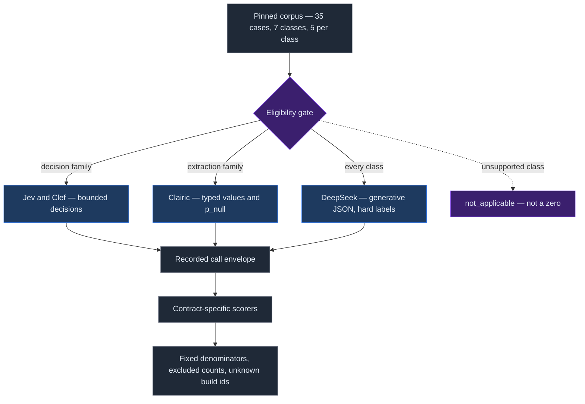
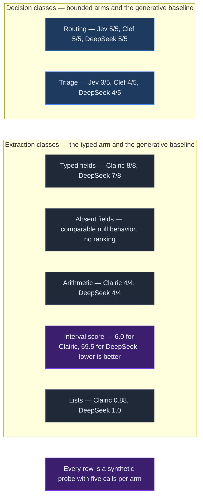

# Specialized Inference Is Not a Smaller LLM

A validator told us an extraction had succeeded because the response included a source span. The response had, in fact, refused the extraction.

That distinction matters. An absent-value result from a typed extraction system can contain several useful pieces of evidence: a null probability, the candidate value it rejected, and the span that caused the rejection. A validator that asks only whether a span exists converts a principled refusal into a false success. The model did the careful thing. The measurement erased it.

This was the most transferable result from a small benchmark of specialized inference and a generative model. It was not a leaderboard result. It was a warning about shape. Systems that return a bounded choice, systems that return typed values, and systems that generate structured text expose different evidence. If we force those outputs into one score, the benchmark can become more confident as it becomes less truthful.

We compared four arms on 35 synthetic cases across seven classes, with five authored cases per class. Jev and Clef made bounded decisions. Clairic extracted typed values and returned `p_null`. DeepSeek Flash generated JSON without a thinking pass. The run was serial at concurrency one. Those constraints make the results useful as an engineering probe, not as a ranking.

The thesis that survived the run is narrow: specialized “System One” models are not simply smaller or faster versions of a generative model. They are differently shaped, and that shape changes which failures can be represented.

## Start with eligibility, not scores

The benchmark divided work into two families.

Bounded-decision arms attempted routing and triage. Typed-extraction arms attempted field extraction, absent-field handling, arithmetic, interval estimation, and list extraction. DeepSeek attempted every class. Clairic did not attempt decision classes. Jev and Clef did not attempt extraction classes.

That separation is part of the result. An unsupported class is `not_applicable`, not zero. We did not compute a cross-class winner.

This prevents a common benchmark failure. If an arm fails before producing an answer and the denominator quietly shrinks, its reported accuracy can improve. If an arm cannot perform a class and receives a zero, a capability boundary becomes an accuracy claim. Both choices distort the question. Eligibility must be fixed before scoring. Every scored ratio needs its denominator, excluded count, and sample size.

The correction showed why. DeepSeek’s typed-field exact match is 7 of 8 scored observations, or 0.875, with one observation excluded. An earlier count said “all five cases.” That was wrong in two ways: it treated an observation ratio as a case count, and it let an incomplete answer disappear. The answer `52` did not match the gold value `52 hours`. After the scorer repair, that observation counts as wrong.

Clairic’s typed-field exact match is 8 of 8 scored observations, or 1.0, with one observation excluded. This does not establish that Clairic is the better model. The corpus is synthetic, the gold values and scoring rules were authored together, and the number of observations is too small for ranking.

*Figure 1. The measurement shape: corpus, eligibility gate, recorded envelope, contract-specific scorers, and the guardrails that keep missing evidence visible.*

## The specialist difference was class-shaped

Arithmetic produced the same score for both eligible arms. Clairic and DeepSeek each matched 4 of 4 scored observations, or 1.0, with one observation excluded per arm.

List extraction differed. DeepSeek’s item F1 was 1.0 over 8 scored items, equivalent to 8 of 8 under the supplied evidence row. Clairic’s item F1 was 0.88 over 8 scored items, represented as 7 of 8 in the corrected evidence, with one excluded observation per arm. The difference is useful because it exposes a type-level boundary. A list representation can split or combine items in ways that matter downstream. It does not prove a general quality ordering.

The clearest separation appeared in interval estimation. Clairic’s 80% interval score was 6.0 over 4 scored observations from five calls, with one observation excluded. DeepSeek’s was 69.5 on the same basis. Lower is better for that scoring rule. The result supports only a class-specific claim: a typed model that natively expresses an interval behaved differently from a generative model asked to serialize one on these five synthetic probes.

Decision results were mixed. Jev, Clef, and DeepSeek each answered 5 of 5 bounded-routing cases correctly. In text triage, Jev answered 3 of 5 correctly, while Clef and DeepSeek each answered 4 of 5 correctly. These are observations about authored probes, not estimates of future error rates.

*Figure 2. Result shape by class. Each arm scored only the classes it could attempt, and every number carries its own denominator.*

This is why “which model won?” is the wrong question. The useful question is: which output contract matches the failure mode we need to control?

## Accuracy and calibration are different measurements

A generative baseline that emits a hard label can be scored for top-one accuracy. It cannot be treated as if it emitted a calibrated probability.

We therefore marked DeepSeek’s Brier score `not_comparable`. We did not assign zero, which would imply perfect calibration, or one, which would imply maximal error. Missing calibration evidence is neither.

The bounded-decision arms did expose probability-like outputs. On routing, Jev scored 5 of 5 correct with Brier 0.0 over five calls. Clef scored 5 of 5 correct with Brier about 0.0019 over five calls. On triage, Jev scored 3 of 5 correct with Brier about 0.3513 over five calls. Clef scored 4 of 5 correct with Brier about 0.0557 over five calls.

The important point is not the ordering. A bounded decision can be correct and still poorly calibrated. A hard-label generator can be accurate while providing no calibration measurement at all. Production routing often needs both: the choice determines the path, while calibrated uncertainty determines whether the system may act without escalation.

## End-to-end latency is a systems measurement

The latency results looked dramatic and were easy to overstate.

Clef’s two class medians were 18.718 seconds and 18.682 seconds, with five calls behind each figure. Clairic’s class medians ranged from 18.594 seconds to 18.922 seconds, with five calls behind each figure. Jev’s medians were 0.302 seconds and 0.289 seconds, again with five calls per figure. DeepSeek’s class medians ranged from 0.634 seconds to 0.979 seconds, with five calls per class.

Those are end-to-end wall-clock observations from one host. They include provider serving, gateway behavior, queuing, transport, and network effects. They are not isolated model times.

The p90 values require even more care. Each class had five calls, so the reported p90 is the maximum rather than a distribution property. Jev’s routing median was 0.302 seconds and its reported p90 was 8.483 seconds, both from five calls. Before making a production claim, we would need repeated runs and a decomposition of queue, network, gateway, and model time.

## Cost follows request shape

Every amount in this run was small, but the accounting bases were not uniform.

The Gateway reported a charge of $0.000176736 for Jev’s 10 calls. Clef’s estimated charge was $0.00065064 for 10 calls. Clairic’s estimated charge was $0.0007198 for 25 calls. DeepSeek’s estimated charge was $0.00158715 for 35 calls at the stated off-peak rate. These are estimated charges from measured usage at the stated rates, except for Jev’s Gateway-reported charge. They are not provider bills.

The totals are not a general price ranking. The arms attempted different work. DeepSeek’s rate also varies by time window, and the run cannot prove which billing tier the provider applied.

The more reusable observation was inside extraction requests: the field specification consumed more input tokens than the document text. The schema was the larger part of the prompt.

Extraction cost therefore scales with more than document length. It also scales with field count, descriptions, constraints, examples, and null semantics. A pipeline that asks for every conceivable field on every document can spend more on the contract than on the evidence. Measure schema tokens and document tokens separately. Route narrow schemas where possible.

## Provenance has a hard limit

The repair also exposed a provenance limit. The harness had written the requested model name into a revision field, and one provider echoed that name. An echoed request alias is not a build identifier.

Only DeepSeek reported a provider build identifier: `e72d3c7f663d3e1383b00b3884cb4501`. The build identifiers for Jev, Clef, and Clairic are unknown. No arm should be described as pinned or stable from this run.

That absence is a result. Filling it with a model alias would make the report look complete while weakening it. “Unknown” preserves the boundary between what the caller requested and what the provider proved it served.

## How the benchmark could have lied

The scorer repair showed several ways a clean report can be less true than a messy one.

A failed or incomplete attempt can disappear from the denominator. A hard label can be mistaken for calibrated evidence. An unsupported class can become a zero. A requested model alias can be presented as a recorded build. A provenance span can turn a refusal into an apparent success.

The fixes share one principle: measured beats reported. Preserve failed observations. Keep `not_applicable`, `not_comparable`, and `unknown` distinct. Validate the semantic outcome, not the mere presence of a field. Record corrections instead of silently rewriting history.

The gold values and scoring rules were authored together, so the benchmark does not have independent adjudication. That is another reason to treat it as a measurement probe rather than a model comparison.

## What to measure in your own pipeline

Start from the action contract.

For bounded routing, measure eligibility, top-one correctness, calibration, abstention, and the cost of a wrong route. For typed extraction, measure exactness by field, null behavior, rejected candidates, provenance spans, parser behavior, and downstream validation. For intervals, use a proper interval score. For lists, score item boundaries as well as semantic content.

Keep latency end to end for service planning, but instrument its components before attributing a cause. Separate schema tokens from document tokens. Keep live execution evidence distinct from offline rescoring. Pin the corpus and preserve recorded calls, while admitting that provider execution is not reproducible when build identifiers are unavailable.

Most importantly, do not demand one winner from systems that produce different evidence. A specialized model earns a place when its output contract removes a failure mode that matters: calibrated routing, explicit null probability, typed intervals, or constrained values. A generative model earns a place when flexibility across classes matters more than native structure.

This benchmark did not show that System One models are universally faster, cheaper, or more accurate. It showed where specialization becomes visible—and how easily measurement can erase that visibility.

## Practical Takeaways

- Measure the output contract, not only the score. Every scored ratio needs its denominator, its excluded count, and its sample size.
- Treat an absent value as evidence. Read `value` and `p_null`, not the presence of a span.
- Keep `not_applicable`, `not_comparable`, and `unknown` distinct. Never convert any of them to zero.
- Keep the requested model alias apart from the provider build identifier. If the provider reports no build, record `unknown`.
- Measure accuracy and calibration separately. A hard label carries no probability.
- Report latency end to end, then instrument its parts before you attribute a cause. At five calls, the reported p90 is the maximum.
- Measure schema tokens apart from document tokens. The contract can cost more than the evidence.

## Positioning Note

This note reports an engineering probe, not a model ranking. Seven synthetic classes with five cases each cannot rank systems, and no production swap is measured here. The claims are about output shape and measurement discipline: which failure modes an output contract can represent, and which evidence a score quietly discards. The validator refusal story is the load-bearing example, and it is accurate.

## Status & Scope

The corpus is synthetic and private. The runs, the recorded calls, and the scoring code stay in a private repository, so the numbers here are not independently reproducible. Gold values and scoring rules were written together, so the gold is not independently adjudicated. Latency figures come from one host and one run, include gateway and transport time, and rest on five calls per class. Only DeepSeek reported a provider build identifier; the other three arms cannot be pinned. Research synthesis and this draft were prepared with AI assistance.
