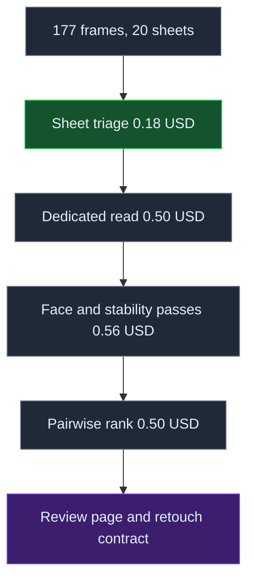
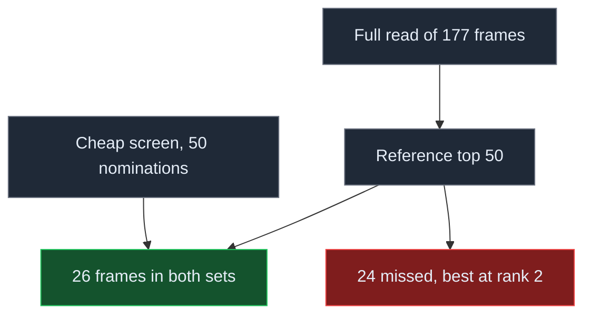

# The Assistant That Killed Its Own Optimizations

## Selection is an evidence problem

A photo shoot does not usually produce a neat ladder from failure to success. It produces near-peers: similar light, repeated poses, small changes in expression, and many frames that are defensible for different reasons. The hard part is not choosing one image over another. It is constructing enough comparable evidence to understand what the choice means.

I tested that proposition on one studio shoot: 177 raw frames, 3.86 GB, four setups, one subject, one operator, and one vision model. That boundary matters. This is an engineering report about one system on one shoot, not a claim that its error rates generalise to photography.

The pipeline began conventionally. It copied the originals, generated labelled contact sheets, asked a model to nominate likely finalists, read selected frames at higher resolution, inspected face crops, measured repeatability, and attempted a pairwise ranking. Each stage produced an immutable artifact with its inputs, outputs, token counts, and cost. Each stage could resume by input hash.

*Figure 1 — Stage order, with the incremental cost of each paid pass.*

What changed the project was not better prompting. It was treating selection as a measurement program. The screen was tested against a full read. The ranking was required to express uncertainty. A second pass tested whether the model would make the same decision twice. The system was allowed to disprove its own shortcuts.

The result was more useful than a polished demo: two proposed optimizations failed, and a third measurement showed that the apparent ordering at the top was unstable.

## The cheap screen was not cheap

The first optimization was a two-tier funnel. A relatively inexpensive contact-sheet pass nominated frames for individual inspection. This is a natural design: spend little on the full population, then spend more on the promising subset.

But a funnel is only an optimization if it preserves recall. We therefore paid for a complete individual read of all 177 frames and treated that result as the comparison set we could afford.

The nomination stage recovered 52% of the full read’s top 50 and 70% of its top 10; it missed 24 of the top 50, including the frame ranked second by the full read.

*Figure 2 — Nomination recall against a full read of the same 177 frames.* The screen cost $0.1837, while the new work required to read the complete set cost $0.4990.

That is not a useful trade. The inexpensive stage consumed more than a third of the marginal full-read cost while removing nearly half of the strongest candidates. More importantly, the loss was silent. Without the full read, the nominated set looked plausible. Every downstream stage could have been internally consistent while operating on the wrong population.

This is the first lesson from selection systems: precision within a shortlisted set says nothing about recall from the source population. A pipeline can produce excellent explanations, stable JSON, and attractive review pages while permanently excluding the best material. The missing evidence is not visible in the deliverable.

Measuring recall forced us to pay for the pass the optimization was meant to avoid. That sounds circular, but it is how an optimization earns the right to exist. A cheaper stage should begin as a hypothesis, run in shadow against a complete method, and survive only after its recall is known. Otherwise “efficient” means only that the discarded items were never inspected.

## A ranking can honestly return a plateau

The second optimization attempted to turn the strongest set into a defensible order. Absolute scores are vulnerable to drift, so the pipeline used sparse pairwise comparisons and a Bradley–Terry model. The model saw small groups of comparisons, the solver estimated relative strengths, and confidence intervals were supposed to distinguish clear leaders from near-peers.

The pairwise run used 115 judgments in 23 batches and cost $0.5048. Its tier result was A: 0, B: 50, C: 0. The median 95% interval was 3.84 log units, wider than the complete observed score range from 1.5 to -1.45.

The point estimates still formed an order. It would have been easy to publish that order and call it a ranking. The intervals made the more important statement: the evidence did not support the separation. At the approved budget, every candidate belonged to one broad plateau.

That conclusion was not a runtime failure. It was the correct product of the stage. A ranking system needs permission to say “these alternatives are indistinguishable at this resolution.” Without that state, a numerical solver converts uncertainty into false precision.

The approved cap also mattered. Resolving the plateau to roughly half a log unit was estimated to require 250–300 judgments and about $1.10. That may be worthwhile for another use case, but it was outside the decision already made for this one. The system did not quietly turn a request for selection into an open-ended tournament.

The dedicated reads showed the same instability from another direction: 28 of 50 verdicts changed between the sheet view and the individual-frame view. A repeat read of the top eight classified three as robust and five as unstable, with none in the intermediate category. The face pass found 44 sharp and six soft frames, but every top-20 frame received the same high face-quality score, so that evidence confirmed the band without ordering it.

The full individual read ended with 10 keeps, 91 maybes, and 76 rejects. That distribution is not a failure to decide. It describes the actual topology of the set: a small delivered group, a large plateau that still requires taste, and a substantial reject region.

## Autonomy came from the harness

The pipeline ran across four calendar days, from 2026-10-19 through 2026-10-22. Most of the delay was not computation. It came from waiting at decision boundaries: approve another paid stage, accept a flat tier instead of a ranking, or authorize an irreversible file operation.

The assistant performed the reversible work unattended. It wrote the stage scripts, built the proxies and contact sheets, executed the paid reads, reused cached responses, measured nomination recall, implemented the pairwise layer, ran acceptance programs, and assembled the review and retouch surfaces. When delegated code produced truncated responses, an invalid cache key, and a solver edge case, those defects were found before delivery.

None of this required a general permission to “be autonomous.” The permission was encoded mechanically:

- stages were resumable by input hash;
- paid calls had explicit caps and a preflight refusal;
- acceptance programs checked artifact shapes, counts, cache consistency, and cost;
- artifacts were immutable once delivered;
- irreversible actions stopped for one human decision.

That last rule was exercised, not merely documented. The working folder contained 147 byte-identical duplicates. After explicit approval, 146 duplicates were moved to trash and the folder settled at 180 items: 177 images and three folders.

The asymmetry is deliberate. Rebuilding a derived JSON file is cheap and reversible, so the assistant can do it. Increasing an approved budget changes the operator’s commitment, so it asks. Replacing a delivered artifact can invalidate someone else’s work, so it asks. Deleting files removes optionality, so it asks.

This gives a more precise definition of practical autonomy: the assistant may cross reversible state transitions on its own, while irreversible or commitment-changing transitions require explicit authority. The model does not need to infer the boundary from prose each time. The harness exposes it.

A second model participated through the same structure. It reviewed the design through a durable request, returned bounded improvements, and did not become a runtime dependency. The operator accepted only the proposals that fit the existing cost rule. External critique became input to the process without becoming another opaque service in the critical path.

## What this gives an expert

The strongest case for an assistant is not that it replaces expert judgement. It changes which questions are economically askable.

A photographer can suspect that a screen loses subtle frames, but measuring that suspicion requires a full alternative pass, a join between candidate sets, and a recall calculation. An expert can feel that a ranked shortlist is really a plateau, but testing that feeling requires repeated comparisons, an uncertainty model, and a stopping rule. A retoucher needs a contract, not a folder plus prose: selection state, evidence about the face crop, observed flaws, and the work requested.

The assistant turned those open questions into executable experiments and left the evidence in forms the expert could inspect. It did not require the expert to learn an API, design a cache, reconcile partial runs, or remember which result came from which model invocation. The user supplied the questions, budgets, and decision boundaries. The system supplied the experiment.

The leverage comes from iteration, not from a single answer. Once an experiment is encoded as a resumable stage, the expert can change one assumption, replay only the affected work, and compare the new artifact with the prior one. The assistant absorbs the bookkeeping while the expert spends attention on whether the question was worth asking and whether the evidence changes the decision.

This is empowerment in a narrow, testable sense. It is not “AI makes everyone an expert.” The operator already owns the domain and remains responsible for the aesthetic objective. The assistant expands the expert’s investigative bandwidth: more hypotheses can be tested before the cost of implementation exceeds the value of the answer.

That distinction matters because the model’s language sounds more authoritative than its measurements. Terms such as “flat lighting” or “dead gaze” are useful as indexes into a frame, but they are not calibrated scales. In this run there was no labelled truth set for quality. There was model agreement, disagreement, stability, recall against another model pass, and a human’s eventual decision—but no ground truth for taste.

The next useful system is therefore not a more elaborate ranker. It is a small labelled calibration set owned by the operator, plus a release gate that compares pipeline changes against it. Until then, the model should remain an evidence engine rather than a judge.

## The useful failure mode

The total measured program cost was $1.9684. For that amount, the system produced a delivered set, an auditable review surface, and three negative findings about itself: the screen destroyed recall, the ranker could not resolve the plateau within budget, and the top verdicts were unstable.

Those negative results are the article’s main result. A less instrumented pipeline would have returned a shortlist and a ranked folder. Both might have looked convincing. This system was useful because it could show where its own confidence was unsupported.

Selection begins as taste, but a selection pipeline is an evidence system. Its job is to preserve the population, make comparisons commensurable, expose uncertainty, and stop when further resolution costs more than the decision warrants. The assistant can run much of that process autonomously when the harness makes cost, reversibility, provenance, and authority explicit.

The human still defines “good.” The assistant makes it cheaper to discover what the system actually knows.

## Practical Takeaways

- Measure the recall of a cheap screen against a full pass before you trust it. Ours kept 0.52 of the top 50, and the nominated set looked plausible the whole time.
- Build the ranking layer so that it can return one tier. An order the intervals cannot support is worse than no order, because someone will act on it.
- Stage the rescue before the deletion. We found 147 byte-identical duplicates, moved them, and deleted nothing until the operator approved.
- Price the question before you ask it. Recall cost 0.50 USD and the plateau answer cost 0.50 USD, and those two answers changed the pipeline more than any prompt change did.

## Positioning Note

This note reports one measured run of a selection pipeline on one shoot. Its contribution is not a new model, metric or dataset. It is the record of a pipeline that was allowed to disprove its own optimizations, plus the account of the harness that made running it safe.

## Status & Scope

Conceptual engineering report on a single personal study. Not a product specification, not a benchmark, and not a claim about photography in general. One shoot, one vision model, one operator. The rates here describe this system on this population. The underlying artifacts are the operator's own records and are not published with this note.
